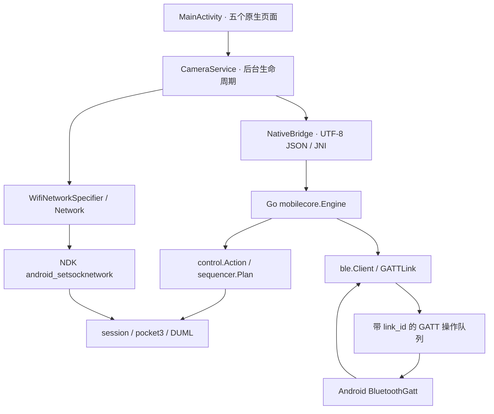

# openMimo Android

原生 Android 界面 + Go 协议/控制核心，目标 Pocket 3 / HG212。应用包名 **`dev.openmimo`**，与原版 Mimo 并存；不修改原版 APK。

当前产物：[openmimo-0.1.0-arm64-debug.apk](../bin/openmimo-0.1.0-arm64-debug.apk)。支持 **Android 10+、arm64-v8a**，target SDK 35，使用本项目独立开发签名。已安装到 `kf6x7l85cq6tpflv`，通过 25 项离线断言，并完成 Pocket 3 独立配对、热点交接、TCP/UDP 会话和状态读取；用户确认云台会动、归中正常。其他功能需逐项验收，见 [实机记录](../docs/HARDWARE.md)。

## 页面与功能

真机界面：[连接](screenshots/connection.png) · [拍摄](screenshots/camera.png) · [云台](screenshots/gimbal.png)。截图来自提供的 Android 手机，处于未连接相机状态。

| 页面 | 已接入内容 |
|---|---|
| 连接 | 当前 Wi-Fi 连接、指定 SSID/密码加入、DJI/Pocket BLE 扫描、GATT 发现、Go 配对状态机、相机确认、AP 凭据交接、断开、离线自检 |
| 拍摄 | 拍照、开始/停止录像、模式、分辨率/帧率/慢动作倍率、编码、曝光、ISO/ISO MAX/快门/EV、白平衡、色彩、对焦、Pro、RAW、延时、全景；状态与格式能力读回 |
| 云台 | 按住方向移动、松开归零、速度调节、归中、实验性绝对 yaw/pitch 角度 |
| 任务 | 间隔拍照脚本生成、JSON 校验与执行、云台往返示例、进度、取消；支持后台前台服务执行 |
| 日志 | 有界本地事件日志、复制/清空、第三方许可 |

按钮接入真实协议接口；“收到应答”与“动作完成”分开处理。参数和模式是否支持取决于目标固件。没有相机连接时拍摄按钮禁用，离线自检始终可用。当前不提供实时视频预览、媒体文件下载、固件刷写或新固件模式解锁。

## 使用顺序

1. 首次测试优先用原版 Mimo 配对并确认相机能正常工作，退出 Mimo，手机加入相机热点。在 openMimo 的“连接”页选择 **连接当前 Wi-Fi**。
2. 独立配对路径为：扫描 → 选择 Pocket 3 → **配对并连接** → 相机屏幕确认 → Android 系统 Wi-Fi 加入对话框。该路径已在提供的 Pocket 3 上走通；配对标识采用 32 字符，连接时请求 ATT MTU 517，避免长通知被截断为 20 字节。
3. 连接后先读状态和格式能力表，再逐项设置参数、读回结果。首次云台测试用小幅移动与归中。
4. “任务”页先校验脚本再运行。取消会停止后续步骤与云台；已开始的录像由“停止录像”按钮显式结束。

使用当前 Wi-Fi 不要求蓝牙扫描权限。BLE 与 Wi-Fi 请求各自所需的附近设备/旧版定位权限按操作申请。通知权限是可选的，不会阻断连接。Android 的 Wi-Fi 加入确认由系统提供，见 [Wi-Fi Network Request API](https://developer.android.com/develop/connectivity/wifi/wifi-bootstrap)。

## 框架结构



- `mobilecore` 独立于 Android，负责连接状态、事件、参数控制、脚本调度和云台看门狗；相机会话通过接口隔离，允许主机上注入模拟会话测试。
- JNI 使用 UTF-8 **byte[]**，避免 Modified UTF-8 对表情字符和补充平面的处理差异。JNIEnv 不跨线程保存，界面线程不执行 Go 的阻塞网络请求。
- Java 服务分别使用普通工作线程、快速 BLE/操控通道、事件轮询通道；GATT 操作只在收到 Android 回调后完成，按次序执行，超时失败。操作 ID 和 link ID 防止旧连接回调写入新相机。
- 每个 Go TCP/UDP socket 都通过 `session.Config.SocketControl` 与 [NDK `android_setsocknetwork`](https://developer.android.com/ndk/reference/group/networking#android_setsocknetwork) 绑定所选 Network。不能仅假设 Java 的进程默认网络会覆盖 Go 原始 socket。
- 手动云台更新有效期 250 ms，Go 每 50 ms 处理；UI 停止更新或离开页面时发送归零。此机制依赖进程和链路仍可运行，不保证强杀进程/断网后的相机状态。
- 后台使用 `connectedDevice` 前台服务、可见通知和有期限的 partial wake lock。移除任务或显式断开会取消脚本、关闭相机会话并释放无线请求；进程重启不会自动重放拍摄任务。参考 [Android connected-device 服务](https://developer.android.com/develop/background-work/services/fgs/service-types#connected-device)。
- Wi-Fi 密码不写入 SharedPreferences，也不广播到 UI 日志；只在 Go → Java 的内部凭据事件中传给系统连接 API。保留的偏好为相机地址、配对 identifier 和用户脚本。

## 脚本格式

```json
{
  "version": 1,
  "name": "间隔拍照",
  "repeat": 3,
  "steps": [
    {"action": {"type": "photo"}},
    {"wait_ms": 5000}
  ]
}
```

每一步恰好包含 action 或正数 wait。先验证整个计划再执行第一步；1–256 步、1–1000 次重复、最多 5000 总步骤、累计等待/云台移动最多一小时。错误或取消停止后续步骤，不自动重试。等待发生在前一个动作应答之后，故这里的 5000 ms 表示“拍照后等待”，不是硬实时快门周期。

部分动作示例：

```json
{"type":"record-start"}
{"type":"record-stop"}
{"type":"mode","mode":1}
{"type":"video-format","resolution":16,"fps":6,"speed_ratio":0}
{"type":"iso","iso":400}
{"type":"shutter","shutter_denominator":60}
{"type":"white-balance","kelvin":5600}
{"type":"gimbal-recenter"}
{"type":"gimbal-jog","yaw":100,"pitch":0,"duration_ms":1200}
{"type":"gimbal-angle","yaw":100,"pitch":0,"duration_ticks":10}
```

`gimbal-jog` 的方向值是 joystick 偏移，持续时间 50–60000 ms。`gimbal-angle` 的数值为 0.1 度，当前应用只公开 yaw/pitch；duration_ticks 为原生字段，绝对坐标/时间语义仍需相机确认。其他受支持动作与校验在 `control/action.go`；轨迹点通过 `motion-point` 的 `remove` 表示删除，复杂轨迹编辑仍属实验接口。

## 构建

不依赖 Gradle 下载或额外 Java/Go 库，使用 Android SDK 工具链直接构建。当前工作站：Go 1.27.1、JDK 17、NDK r29、Android SDK platform 35 / build-tools 36.0.0。

```powershell
./scripts/build_android.ps1
./scripts/build_android.ps1 -Install -Device kf6x7l85cq6tpflv
# 也可指定 -SdkRoot -NdkRoot -JdkRoot -Go
```

脚本生成 Go c-shared `libmimo.so`、编译 Java、D8 转 DEX、AAPT 打包、zipalign、开发签名与签名校验。签名保存在忽略的 `android/.keys/`，构建中间文件在 `android/build/`；同一签名可覆盖安装保留偏好。产物与哈希记录在 `analysis/android-build.json`。开发签名和测试入口不作为商店发布配置。

## 验证

```powershell
go test ./...
go vet ./...
adb -s kf6x7l85cq6tpflv shell am instrument -w dev.openmimo/.SmokeInstrumentation
```

本轮 Go 检查：**80 项（含子测试），9 个有测试的包通过**。Android 真机：**25 项断言通过**，包括 JNI 核心自检、UTF-8、五页面控件、未连接禁用、NDK Wi-Fi socket 绑定（不发包）和 connected-device 前台服务启动。还通过模拟会话验证了脚本取消后不继续拍摄、云台 UI 更新过期后发归零指令，以及 GATT ACK/关闭行为。

已验证 BLE 配对、AP 交接、UDP 会话、状态推送及用户观察到的云台归中。参数生效、格式能力表、姿态坐标/限位、脚本与异常断线行为仍待验收。相机未回显属性 transaction，界面通过 `observe-property` 等待下一条实时推送并明确标注非请求关联。`files/diagnostics.json` 每秒保存一份应用私有的状态与读取结果快照，`files/connection.log` 保存最近 180 条连接事件；二者不保存 Wi-Fi 密码。

